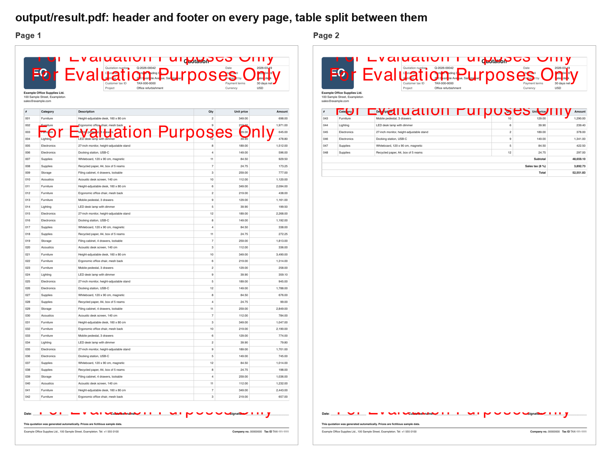

# Nutrient HTML to PDF Layout

A Nutrient.io demo that builds one paginated A4 PDF from three HTML files with GdPicture.NET: a header and a footer repeated on every page, and a content page whose main table flows across as many pages as needed.



*Generated in evaluation mode: every HTML conversion and the final PDF carry a watermark.*

1. **Probe.** The header is converted once to measure the width the GdPicture HTML engine renders at. A CSS zoom is computed from it, so that text stays readable once the page is scaled down to A4.
2. **Header and footer.** Both HTML files are converted to PDF with `GdPictureDocumentConverter`, scaled to the same width, and measured. Their heights, the paddings and the gaps give the height left for content on each page.
3. **Content split.** The table with the most rows in the content HTML is split with HtmlAgilityPack. Header rows (`<th>` only) are repeated in every chunk. Data rows are packed from an average row height, then each chunk is converted and checked, and rows are moved to the next chunk until it fits.
4. **Page assembly.** Header, footer and chunks are merged into one document. For each page the header, the chunk and the footer are duplicated, their MediaBoxes are adjusted, and `MergePages` stacks them into one page. The footer box is extended so the footer sits at the bottom of every page.
5. **A4 output.** Each assembled page is overlaid, scaled down, on a new A4 page with `OverlayPage`, and the result is saved.

Everything runs locally. No cloud service is called.

## Prerequisites

- .NET SDK 10
- Windows, macOS or Linux
- To regenerate the sample HTML files: Python 3 (standard library only).

The project is pinned to GdPicture.API 14.4.1. With 14.4.9, the HTML conversion with `HtmlPageHeight = 1` (height fitted to the content) returns `InvalidParameter`.

## Environment variables

Keys are only read from environment variables, never from code. Start from `.env.example`.

| Variable | Purpose | Default |
|---|---|---|
| `GDPICTURE_LICENSE_KEY` | GdPicture.NET license key | empty = evaluation mode |

In evaluation mode GdPicture stamps a watermark on each PDF it writes, so the header, the content chunks and the footer each carry one. An expired or invalid key stops the program with an `InvalidLicenseException`.

## Build and run

Run these from the repository root.

```bash
dotnet build HtmlToPdfLayout
```

```bash
set -a && source .env && set +a && dotnet run --project HtmlToPdfLayout
```

The result is written to `output/result.pdf`. To use your own files:

```bash
dotnet run --project HtmlToPdfLayout -- path/to/html-folder path/to/result.pdf
```

The input folder must hold one file whose name contains `header`, one with `footer` and one with `content`, all ending in `.html`.

## Usage

The console shows each measurement and the chunks:

```text
Probed native render width = 1446,8 pt, nativeScale = 2,588, zoom = 1,941
Heights: header=273,3 pt, footer=113,5 pt (working coords)
Max content band per page = 1606,1 pt (working)
  Baseline=38,2 pt, full=1932,0 pt, avg row=37,1 pt, ~42 rows/chunk
  Chunk 0: 42 rows, height 1597,5 pt
  Chunk 1: 9 rows, height 372,0 pt
Final page count: 2
Done -> output/result.pdf
```

The HTML engine sometimes fails a conversion with `UnknownImageFormat` on a valid page. The program retries each conversion up to three times and logs the retries.

Layout settings are constants at the top of `HtmlToPdfLayout/Program.cs`:

| Constant | Default | Effect |
|---|---|---|
| `Landscape` | `false` | A4 portrait or landscape |
| `GapHeaderToContent`, `GapContentToFooter` | 12 pt | Space between the blocks |
| `TopPadding`, `BottomPadding` | 24 pt | Space above the header and below the footer |
| `SidePadding` | 18 pt | Left and right margin |

A default font stack is injected in the `<head>` of every HTML file. It applies only to documents that do not set their own `font-family`.

## Samples

`samples/header.html`, `samples/footer.html` and `samples/content.html` are a fictitious price quotation with 48 line items, generated by `samples/generate_samples.py`. The company, the customer and the amounts are invented.

```bash
python3 samples/generate_samples.py
```

## Project layout

| Path | Content |
|---|---|
| `HtmlToPdfLayout/Program.cs` | HTML conversion, content split, page assembly and A4 output |
| `samples/` | Sample HTML files and their generator |
